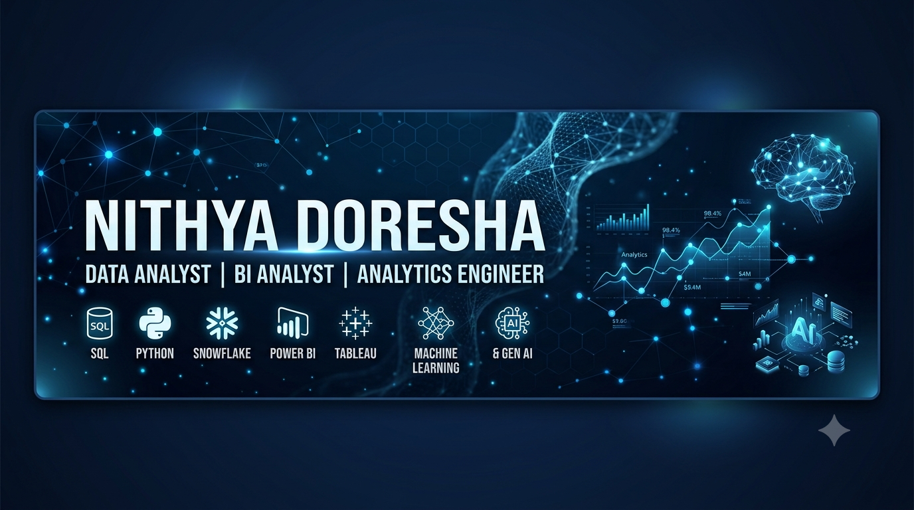

  

# Hi there! 👋 I'm Nithya Doresha

### Data Analyst | BI Analyst | Analytics Engineer

**Turning Data into Insights · Building Intelligent Solutions**

📍 Gothenburg, Sweden

---

## 👩‍💻 About Me

I'm a Data Analytics professional with 3+ years of experience building data products, analytics solutions and AI-powered business applications.

- 💼 Previously worked at **Vonage (Ericsson)** and **Ganit**.
- 📊 Experienced in SQL, Python, Snowflake, Tableau and Power BI.
- 🚀 Built analytics solutions and AI agents adopted by 2,000+ users.
- 📈 Worked on demand forecasting solutions that improved forecast accuracy by 42%.
- 🤖 Interested in Machine Learning, Generative AI, LLMs and AI agents.
- 🌱 Currently expanding my portfolio through hands-on projects.

